# AI 训狗器 (PromptLeash)

**把上下文带走，把回答拉回正题。** Chrome / Edge Manifest V3 扩展，中文界面，纯本地运行。

原创深绿对话框 + 勾选图标，不使用任何 AI 平台标志。本项目独立开发，与 OpenAI、Anthropic、Google、Microsoft 均无隶属或合作关系。

**当前版本：v1.0.2。ChatGPT 已通过真实站点验证；已在真实 claude.ai 实测：v1.0.1 的交接卡、带去新对话只填不发、纠偏、防废话、无扩展报错五项通过。** v1.0.2 已在真实 claude.ai 复测通过（Claude 回复读取完整，包括带路径的句子；请求句和「你来定」类句子不进交接卡；弹窗无滚动条；扩展无报错）。

## v1.0.2 更新

- 修复 Claude 回复读取：优先匹配真实回复节点并读取正文，避免混入隐藏标题和思考状态；保留旧选择器兜底。
- 修复交接卡误收请求句：「请用一句话确认……，暂时不要写代码」不再被当成决策或禁止事项，直接决策与禁令仍保留。
- 修复英文分句：英文句点只在后面跟空白或位于结尾时才断句，路径、文件名、版本号、URL 和小数中的点不再截断句子；配对反引号内不断句，未配对时忽略反引号重新分句。
- 判断决策/禁止关键词前忽略『』、「」、“” 和双引号内的内容，输出仍保留原句；「你来定」「你决定」类委托句不作为决策。
- 收紧弹窗上下间距，600px 高视口内完整显示，不再出现纵向滚动条。无新增功能。

## 功能

- **交接卡**：从当前页面已加载的对话中，用本地规则提取「目标 / 已定决策 / 禁止事项」。目标从前两条用户消息提取，去掉已分类的决策/禁令与纯回复格式指令，去标签、去重，最多 400 字。可编辑、复制，或带去新对话。新页只填入，不自动发送。待交接内容按站点分开，最多保留五分钟，成功插入后删除；已有草稿时不覆盖。
- **一键纠偏**：偏题重来、太长精简、直接给结果、别瞎编、按我的要求重做。默认填入后发送，可在弹窗改为「只填入不发送」。输入框已有草稿时拒绝覆盖。
- **防废话模式**：拦截输入框的普通 Enter 和发送按钮点击，发送前追加一次回答要求。默认 300 字，可设为 50–5000 字。Shift+Enter、输入法组字中的 Enter 不拦截。
- **悬浮面板**：Shadow DOM 隔离样式，可折叠，拖动标题移动并记住位置；弹窗可隐藏面板（防废话仍可独立启用）。
- 所有设置仅保存于当前浏览器设备，不同步。

## 安装：Chrome 与 Edge

1. 下载并解压 `dist/promptleash-v1.0.2.zip` 至固定目录，或直接使用本仓库根目录。
2. Chrome 打开 `chrome://extensions`；Edge 打开 `edge://extensions`。
3. 开启「开发者模式」，选择「加载已解压的扩展程序」，选中含 `manifest.json` 的目录。
4. 在工具栏扩展菜单固定「AI 训狗器 (PromptLeash)」。打开或刷新 ChatGPT / Claude 页面，点击右下角胶囊。
5. 工具栏图标打开设置。更新源码后，在扩展管理页重新加载扩展，再刷新站点。

匹配范围：`https://chatgpt.com/*`、`https://chat.openai.com/*`、`https://claude.ai/*`。

## 使用示例

讨论中明确说「决定采用 CSV，不要联网」。点击「提取当前对话」，检查交接卡后点「带去新对话」。等待输入框出现，确认内容，再自己发送。

纠偏按钮是**给 AI 的新消息**，可能消耗站点额度。防废话字数属于提示要求，不是强制截断，也不能保证模型遵守；请检查真正发送的消息和回答。

## Claude 真实站点截图

交接卡提取和工具栏弹窗来自 **v1.0.2 真实 Claude.ai 复测**；新对话、纠偏、防废话三张来自 **v1.0.1 已登录 Claude.ai 实测**。这些均为真实站点截图，不是隔离 fixture。

**交接卡原始提取：完整保留 SQLite 路径，不误收请求句与委托决策句（v1.0.2）**

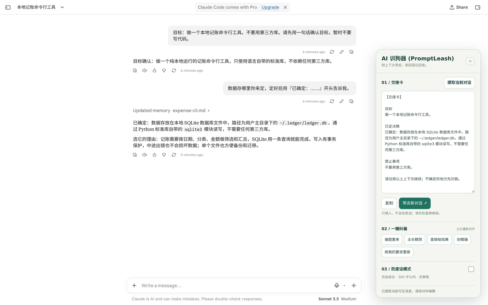

**真实工具栏弹窗：完整显示、无滚动条（v1.0.2）**

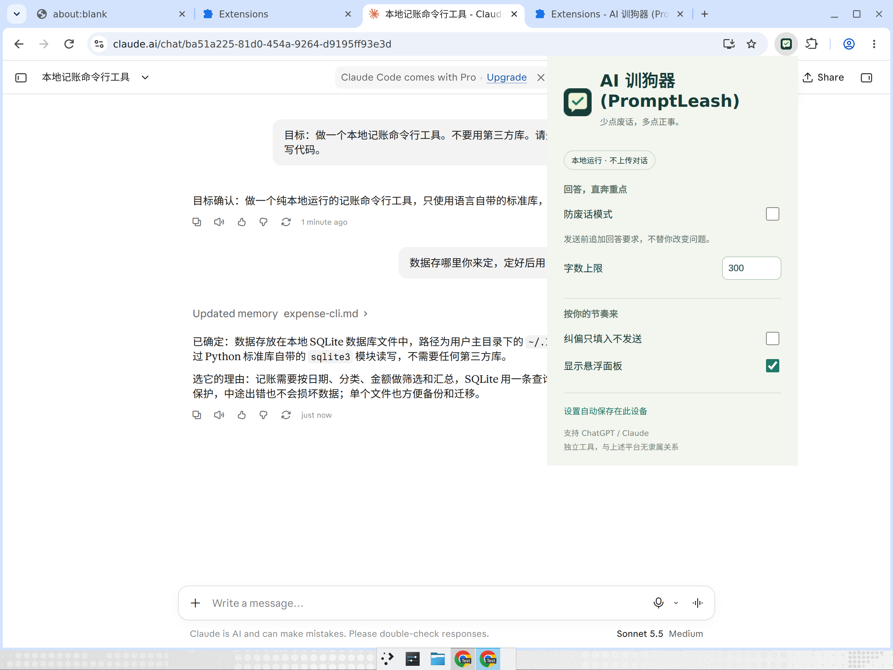

**新对话只填入、不自动发送**

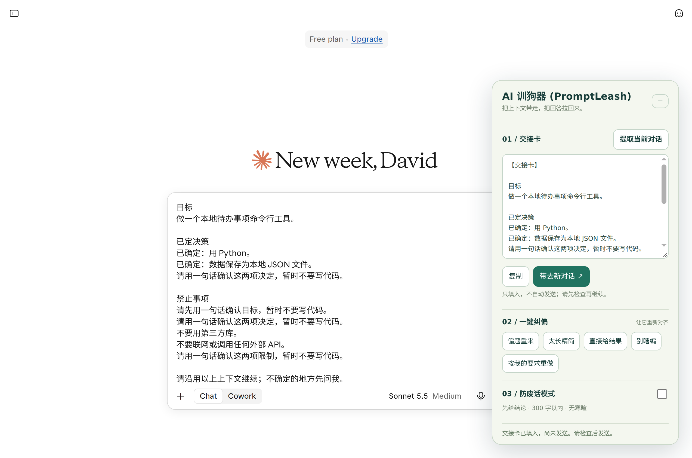

**纠偏实际发送并得到回复**

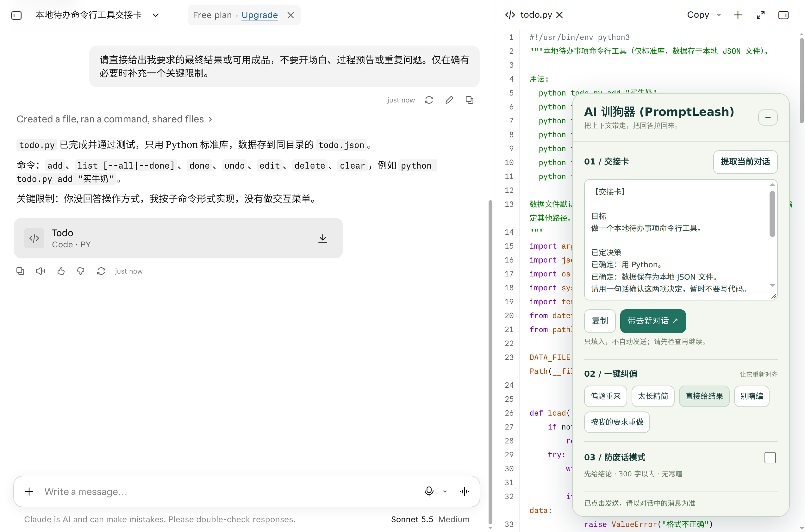

**防废话规则随消息发送并得到回复**

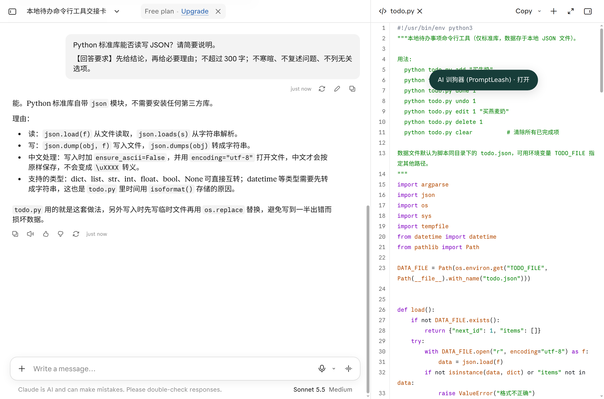

## ChatGPT 真实站点截图

以下截图均来自已登录的真实 chatgpt.com 页面。

**交接卡原始提取**

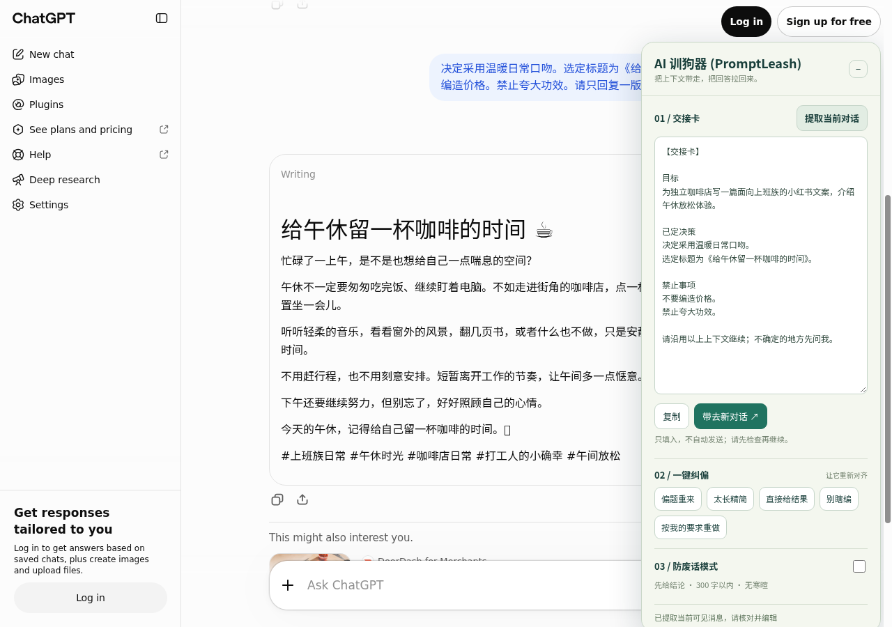

**新对话只填入、不自动发送**

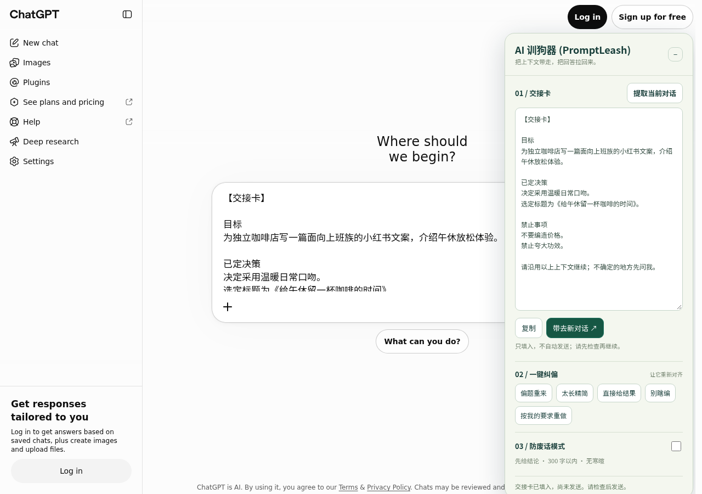

**纠偏实际发送并得到回复**

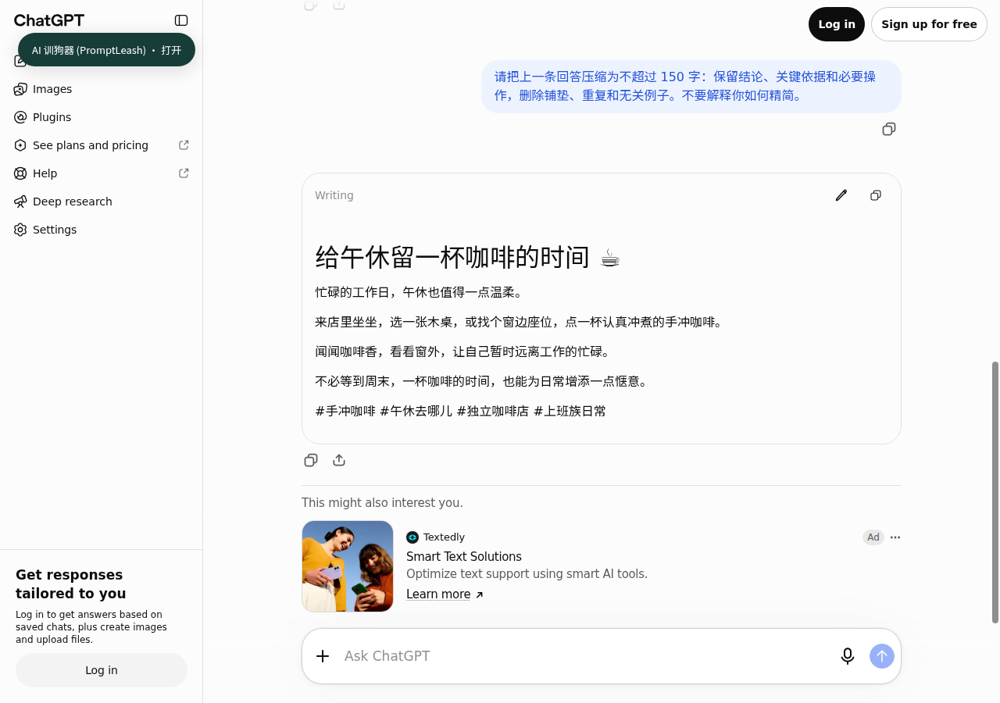

**防废话规则随消息发送并得到回复**

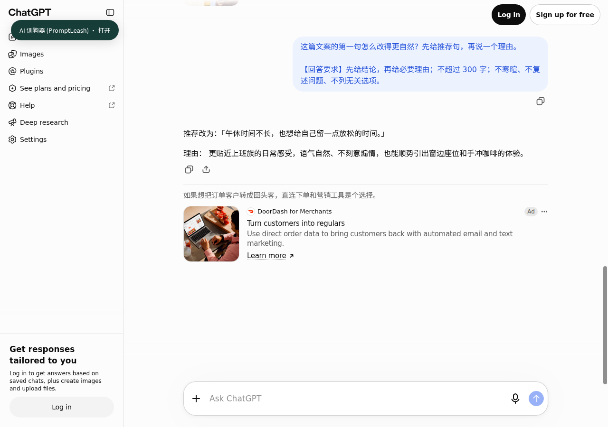

**面板三部分，防废话已开启**

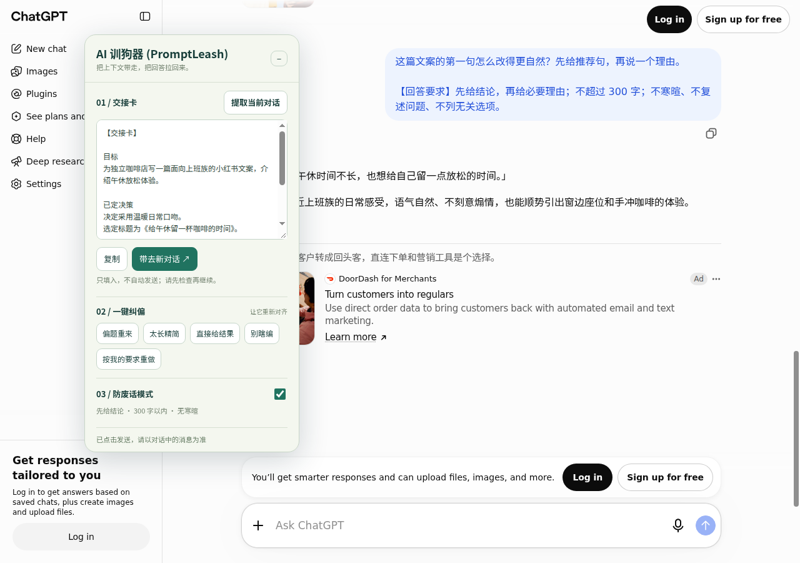

**工具栏设置弹窗**

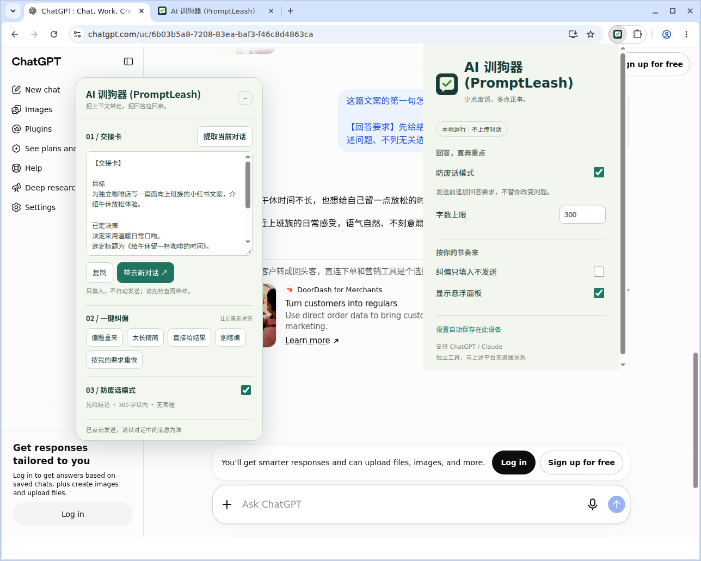

## 隐私与权限

唯一权限为 `storage`；内容脚本仅注入上述三个站点。无后台服务、无 API Key、无分析、无外部网络请求、无远程脚本或字体。网站响应用户发送消息产生的正常网络流量不属于扩展请求。扩展不读取 Cookie 或登录凭据。

对话只在页面中本地读取、按需提取，未提取时不保存历史。仅当点击「带去新对话」时，交接卡文本会暂存于 `chrome.storage.local`，插入后删除；过期内容在下一次受支持页面初始化时清除（关闭浏览器时不会定时物理删除）。编辑预览仅保留在页面内存，刷新会丢失。设置与面板坐标会持久保存。卸载扩展可删除扩展本地存储。

发送和跨站点导航均需用户操作。不自动登录、不绕过站点访问限制。交接卡不会自动跨 ChatGPT / Claude 迁移；跨站点可手动复制。

## 限制与兼容性

- 提取是关键词启发式，不是摘要模型，会误判、漏判、保留冲突或已被推翻的决策。决策和禁令主要来自用户；助手仅接受以「已确定 / 最终决定 / 我们已决定 / we decided」开头且不含问号的明确确认，并排除超过 500 字或 8 句的助手消息。只处理页面 DOM 中已加载的消息，不抓取隐藏历史；请先核对卡片。
- 站点可能更换选择器或发送逻辑。选择器及回退集中在 `adapters.js`。支持 ProseMirror；此次 ChatGPT 未登录实站出现新版 `textarea#mobile-composer-prompt`，也提供兼容。
- 发送按钮忙碌或不可用时最多等待三秒；不会强行发送，草稿保留。不要在此期间继续编辑或重复发送。站点快捷键、语音、其他扩展发消息等路径不保证覆盖。
- 未实现自动折叠长回答。Edge 复用 Chromium MV3 API，但本次未单独运行 Edge。
- Claude.ai 已完成 v1.0.1 五项真实站点测试；v1.0.2 也已在真实 claude.ai 复测通过，确认回复及路径读取完整、请求句与委托决策句不误收、弹窗无滚动条、扩展无报错。测试范围与版本区别见 `docs/verification.md`。

## 开发与打包

需要 Node.js 20+、Python 3；图标重新生成额外需要 Pillow。运行时无第三方依赖。

```sh
npm ci
npm test                # node:test 纯提取与规则单元测试
npm run test:e2e        # Playwright 加载未打包扩展，使用隔离站点夹具
npm run build          # dist/promptleash-v1.0.2.zip
```

`test:e2e` 默认使用本机 `/home/ubuntu/.local/bin/google-chrome`，其他机器可设置 `CHROME_PATH`。夹具通过 Playwright 路由本地响应，无真实 AI 请求；覆盖两个适配器、Enter/点击发送、规则去重、纠偏填入/发送、草稿保护、交接只消费一次/过期、面板隐藏与 DOM 重挂载。

文件结构沿用轻量扩展的 manifest + 内容脚本 + 弹窗 + 原创 PNG 图标 + Node 测试方式，未复制旧项目品牌或网络观察逻辑。

| 文件 | 职责 |
| --- | --- |
| `extract.js` | 可在 Node 运行的纯提取、规则函数 |
| `adapters.js` | 两站点 DOM 选择器、文本读取与插入 |
| `content.js` | 面板、发送拦截、交接生命周期 |
| `popup.*` | 本地设置 |
| `scripts/build.py` | 白名单打包，仅包含扩展运行文件、图标与 MIT 许可 |
| `tests/` | 单元与隔离浏览器测试 |
| `docs/` | 实站验证与截图证据 |

## English

PromptLeash v1.0.2 is an independent, local-only Chrome/Edge MV3 extension for ChatGPT and Claude. It extracts editable handoff cards using heuristics, inserts corrective prompts, and optionally appends concise-answer rules before sending. Only the storage permission is requested. No API keys, analytics, external requests, or remotely hosted assets. Load the unpacked directory from Chrome/Edge's extensions page with Developer mode enabled. Review all extracted content before sending. Site DOM changes may break compatibility. Both ChatGPT and Claude have been tested on the real sites. Claude v1.0.1 passed five checks: extraction, unsent new-chat handoff, corrective prompts, concise-answer rules, and no extension errors. Claude v1.0.2 also passed real-site retesting: complete reply extraction including file paths, exclusion of workflow requests and delegated decisions, a scrollbar-free popup, and no extension errors. English periods split sentences only before whitespace or at the end; quoted text is ignored when matching decision/prohibition cues. Unit and isolated fixture tests provide separate regression coverage, not live-site evidence. MIT licensed.
